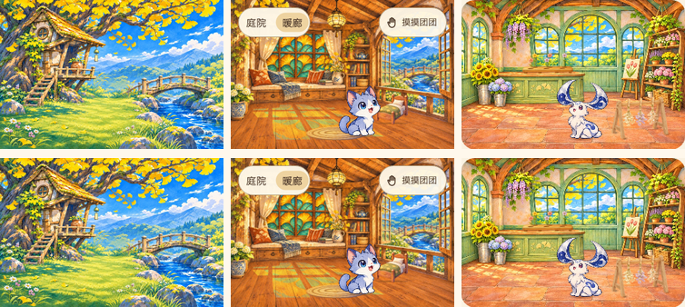

# 0.25.0+26 素材打包复验

`377652e` 将 338 张新增画面编码为 WebP Q94，运行资源共减小 32,249,692 字节。每张图的尺寸与透明通道逐像素一致。编码用 Pillow 11.3.0 和 libwebp 1.5.0，从校验过的 0.24.0 APK 识别历史资源路径。运行清单保留重编码前后的摘要。`tools/check_daily_release.py` 核对 Flutter 打包产物中的 259 个资源 ID 与 642 张图。109 项 Flutter 测试通过。[编码回执](encoding-report.json)

在相同机位对比 `7c545c1` 与 `377652e` 的 809 幅 Flutter 实渲。包含雨后庭院的 125 帧循环及远近落脚、暖廊彩窗与读卷、花店货架与插花，以及奶油、小溪、栗栗的同路径动作。逐帧透明通道相等，三只伙伴的落点、步态和接地记录一致。雨中木构的 7,919 个固定采样点保持稳定。[对比结果](render-comparison.json)

两组图的上排为编码前，下排为编码后。独立复看了奶油的下颌与背心袖口、雨庭木梯和水纹、暖廊彩窗、花店架脚、小溪外套和栗栗围裙。抽检未发现新增的块纹、色晕或糊边。小溪 f205→206 的尾瓣展开与栗栗 f243→244 的收步切换仍可见。[六阶动作实录](../otter-and-hedgehog/README.md#六阶换向)




从未编码的资源工作树暂存重编码输出，可运行以下命令。摘要参考来源为 [0.24.0 原签名包回执](../feeding-0240/package.json)。

```sh
python3 tools/encode_runtime_webp.py /路径/alice-0.24.0-android.apk /路径/编码暂存目录
```

## Android 构建

在独立工作树从 `377652e` 用 Flutter 3.50.0、JDK 21 和 Android SDK 35、36 完成 `flutter build apk --release`。本次通用测试包为 103,619,915 字节（98.82 MiB），低于 100 MiB，余量 1,237,685 字节。三个 ABI 的应用和引擎库、APK v2 测试签名、ZIP 对齐以及包内全部素材清单通过检查。《风过暖廊》的 58 个文件也与源码逐字节匹配。[Android 测试构建回执](android-qa-package.json)

原签名的 0.24.0 下载包通过版本清单检查。0.25.0 测试包使用独立测试证书，家庭更新清单按预期拒绝。原签名出包、Android 覆盖升级和 iPad 签名安装均待验证，家庭下载仍为 0.24.0。
