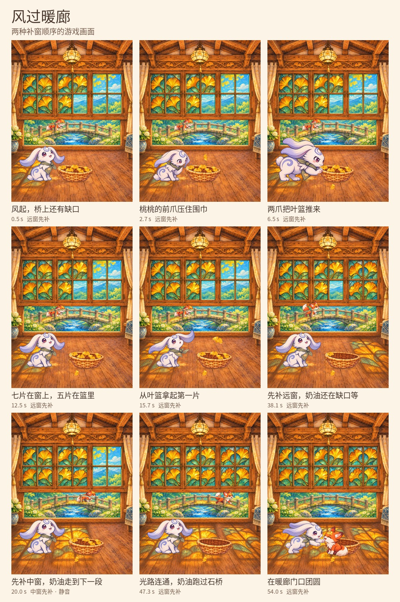

# 风过暖廊 · 0.14.0+11

从原来的「小小伙伴」打开 **小家 → 主线 · 风过暖廊**。故事里的桃桃处于第三阶段，家里的伙伴、穿戴和共享经验由原存档决定。修窗、重玩、观看和试戴都不会产生积分、经验或新物品。

[56 秒游戏画面，固定步长取帧并还原动作声](capture/wind-veranda.mp4) · [取帧方法与两种顺序的原始操作记录](capture/README.md)

## 一次试玩可以看什么

| 玩家操作 | 看画面中的哪一处 |
|---|---|
| 让开场自然演完 | 一片叶子从窗边落下，桃桃转耳、用爪压围巾、俯身推篮、松爪，再朝 Alice 招手。 |
| 从篮里拿一片，补中窗右下角 | 中间的彩玻璃合拢，对应木板和桥面受光，奶油可以走到下一段桥的缺口。 |
| 在另一轮先把四片都给远窗 | 远处的窗与地面先亮。奶油抬眼望向远处，仍在原来的断口等，直到玩家补好中窗。 |
| 补完五处，看完团聚并回小家 | 奶油跑到暖廊，桃桃招手。日常暖廊的窗、靠垫后方及木板上都有新的光影，已购家具位于近景。 |
| 中途离开，或通关后「再演一次」 | 每次嵌叶立即保存。重演会重新摆出七片已有的玻璃，日常暖廊仍保留结局。旧版书签在「章节选项」，通关后可玩「十九片叶子」。 |

右上角喇叭可静音，在同一设备重开也会记住。右上角「章节选项」可收起对白。此章采用逐姿绘画和局部形变，动作音来自七种离线拟音。[角色分层与动作预演](../../../design/production/wind/actors/README.md) · [场景原稿与四种窗光](../../../design/production/wind/room/README.md) · [围巾的六幅家庭穿戴成画](wardrobe.jpg) · [声音来源与试听](../../../design/production/wind/audio/README.md)

同一机位的四张静帧分别取自桃桃刚探爪、双爪贴到篮沿、后腿蹬伸以及迎到奶油的时刻。它们来自 Flutter 绘制的角色与场景。[推篮与迎接的接触帧](paw-contact.jpg) · [奶油等待、望远、跑动和进门](bridge-contact.jpg)

## 已安装的安卓家庭版

在 Android 9 AOSP 云模拟器上，用正式 0.13.0+10 APK 经应用界面新建测试家庭，选择月牙耳兔。从 0.13 原地更新到 0.14.0+11 时，Android 保留首次安装时间和应用 UID。冷启动后，同一家庭仍显示第一阶段桃桃、余额 0、经验 0，首页的主线入口变为《风过暖廊》。从设备取回的 base.apk 摘要与 GitHub 安装包相同。测试时关闭 Wi-Fi 和移动数据。[旧版小家](android/old-home.png) · [新版冷启动](android/new-home-old-family.png) · [同签覆盖记录](android/installed-build.json)

| 已安装应用内的操作 | 实际屏幕证据 |
|---|---|
| 首页进章，看桃桃把叶篮推到窗边 | [连续录屏](android/opening.mp4) · [爪与篮沿接触](android/push-basket.png) · [开场七片玻璃](android/seven-panes.png) |
| 静音并收起对白，补右窗上排两片，中途关闭应用 | [补完两片](android/two-leaves.png) · [冷启动后重新进章](android/reopened.png) · [取叶与落位录屏](android/before-restart.mp4) |
| 先补满右窗，再补中窗最后一片 | [右窗满、狐狸留在缺口](android/far-first.png) · [过桥与进门连续录屏](android/far-first-reunion.mp4) · [实际视频中的脚步与团聚](android/entering-the-room.jpg) |
| 重演时先补中窗，右窗仍空 | 奶油从左侧断口跑到下一段桥柱，原屏横向移动约 100 像素。[中窗亮起的原屏](android/middle-first.png) · [两条路线同机位实装对照](android/branches.jpg) · [重演、补中窗至团聚连续录像](android/middle-first-replay.mp4) |
| 团聚后回到自己的暖廊，再冷启动 | [返回小家的实际画面](android/repaired-home.png) · [同一家庭修前修后](android/home-comparison.jpg) · [重演后再次冷启动，余额与经验均为 0](android/cold-home-after-replay.png) |

实际手机视口为 390 × 844，Android 系统录像输出 384 × 832。开场的系统录像长 61.38 秒，共采到 66 帧。在远窗路线录像里，约 32.8 秒远窗已满、中窗仍缺一格，约 60.5 秒桥路连通，随后奶油跑过桥，在 67 秒左右抵达叶篮边。这个云端软件模拟器适合检查实际点击、画面和存档。手机上的连续帧率、声画延迟与手感仍待实体设备验证。最初使用的 Android 11 测试镜像出现系统网络服务重复重启，本次安装与交互证据取自 Android 9。[安卓原始画面摘要、各段时长与帧数](android/media.json)

独立试玩在静音时靠窗格位置和奶油的姿态分清了修窗进度。小屏上桥面局部变亮较淡，桥上的奶油偏小。竖屏收起对白后，下方仍留有原来的对白空间。

## 家庭数据

0.14 使用 SQLite 结构 6。家庭存档内记录具体哪一格修好、本轮编号、首次通关与旧数学书签。0.13 加密文件可直接恢复到新版本。家庭原有的账本、经验和物品照常使用。[备份步骤](../../BACKUP_MIGRATION.md) · [家庭安装说明](../../DELIVERY.md)

## Android 构建核对

候选 APK 为 0.14.0+11，80,517,060 字节。SHA-256 为 `493b3939daddef425f941a545d01569f435589640651eb419f3d3cffcc14a623`。家庭版包名为 `local.family.alice_companions`，签名证书和 0.13 相同。Android Build Tools 36 已验证签名、16 KB 对齐、Android 8+ 和三种 CPU 架构。[签名与构建信息](installation.json) · [构建日志](build.log) · [静态分析](analyze.log)

将 APK 解包并逐文件对照本标签的 25 张角色及道具图、18 张场景图、6 张围巾穿戴成画、7 个 PCM 音效和 2 份坐标数据。另核对原家庭版的 193 个素材编号。[新增素材核查](packaged-art.json) · [家庭素材核查](family-art.json) · [舞台及连续帧检查](stage-frames.log)

48 项 Flutter 自动测试全部通过，覆盖旧家庭与加密恢复、两种补窗顺序、快速连点、最后一片的声音时序、减少动态效果和试穿零入账。已从 GitHub 的全新检出取回安装文件，大小和字节与签名构建一致。[全量测试](flutter-tests.log) · [GitHub 取回校验](github-download.json)

在仓库根目录可运行 `python3 tools/check_wind_release.py /path/to/family.apk`，在 `apps/mobile` 运行 `flutter test --no-pub --reporter expanded`。iPad 签名、双向真机迁移与实体设备性能仍需可用的 Mac、Apple Team、iPad 和安卓手机。[设备交接](../../DELIVERY.md)
